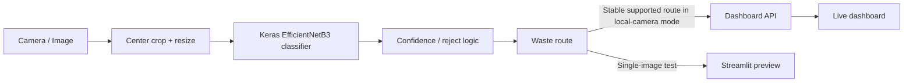

# ♻️ EcoSort

**AI-assisted waste classification and live monitoring prototype for university waste-management workflows.**

EcoSort classifies a waste item from a camera or uploaded image, applies confidence/stability rules, maps accepted predictions to a recycling route, and can publish stable local-camera detections to a live dashboard.

**Live dashboard:** https://ecosort-live.pretty-chord-2514.chatgpt.site/

## What is in this repository?

- `best_model.keras` — trained Keras image-classification model.
- `apps/local_camera.py` — local OpenCV camera mode with stabilized predictions and optional dashboard publishing.
- `apps/streamlit_app.py` — simple browser camera/upload tester for one-image inference.
- `scripts/setup.ps1` — creates a Windows virtual environment and installs dependencies.
- `scripts/run_local.ps1` — starts local camera mode.
- `scripts/run_streamlit.ps1` — starts the Streamlit tester.
- `samples/` — sample images for quick manual testing.
- `MODEL_CARD.md` — model architecture, class order, routing logic, and limitations.

## System flow



The Streamlit tester displays a single-image prediction. Local-camera mode smooths predictions and requires a **3-of-5 vote** before publishing a supported route. Low-confidence and unsupported classes stay out of the dashboard feed.

## Supported model classes

The model outputs eight classes:

`Unknown`, `glass`, `metal`, `organic_waste`, `paper_cardboard`, `plastic`, `textiles`, `trash`.

The current routing prototype directly supports:

| Model class | Route |
|---|---|
| `glass` | `glass` |
| `metal` | `metal` |
| `organic_waste` | `organic` |
| `paper_cardboard` | `paper` |
| `plastic` | `plastic` |
| everything else / low confidence | `other` |

## Quick start on Windows

### 1. Clone the repository

```powershell
git clone https://github.com/elgiar22/EcoSort.git
cd EcoSort
```

### 2. Install dependencies

```powershell
powershell -ExecutionPolicy Bypass -File .\scripts\setup.ps1
```

### 3. Run the Streamlit tester

```powershell
powershell -ExecutionPolicy Bypass -File .\scripts\run_streamlit.ps1
```

Then open `http://localhost:8501`.

### 4. Run local camera mode

Without publishing detections:

```powershell
powershell -ExecutionPolicy Bypass -File .\scripts\run_local.ps1 -NoPublish
```

With dashboard publishing enabled:

```powershell
powershell -ExecutionPolicy Bypass -File .\scripts\run_local.ps1
```

Press **Q** to close the local camera window.

## Local-camera behavior

Default settings:

- Model input: `300 × 300` RGB
- Center ROI: `0.62`
- Confidence threshold: `0.62`
- Inference cadence: every 4 camera frames
- Voting window: latest 5 inference results
- Stable acceptance: at least 3 votes for the same supported class
- Default source: `station-01`

Useful CLI options:

```powershell
.\.venv\Scripts\python.exe .\apps\local_camera.py --help
```

## Dashboard integration

Stable target predictions are sent as JSON to:

```text
POST /api/detections
```

Payload shape:

```json
{
  "label": "plastic",
  "confidence": 0.94,
  "source": "station-01"
}
```

The default dashboard base URL is configured in `apps/local_camera.py` and can be overridden using `--url`.

## Prototype scope

The repository contains the **AI classification and software routing prototype**. A physical actuator/bin-routing mechanism is not included here. The software output can be integrated later with a microcontroller, motors, or another mechanical sorting mechanism.

## Evaluation scope

The repository ships sample images for a manual smoke test. See the [Model Card](MODEL_CARD.md) for class order, routing, the confidence threshold and evaluation limitations. The repository provides no formal benchmark or documented dataset, and the threshold is a routing rule with no calibration guarantee.

## Notes

- The Keras model uses the **PyTorch backend** (`KERAS_BACKEND=torch`).
- The model file is about 79 MiB, so cloning may take a little longer than a typical code-only repository.
- No API keys, passwords, or private tokens are required by the current code.
